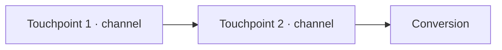

# Journey brief — <campaign / project name>

- **Source spec:** `project-spec.md` v<version> (status: `<hardened|frozen>`, <earned|declared>) · **Mode:** BRAND · **Scope:** GREENFIELD | FEATURE-ADDITION
- **Demolition cycles run:** <n> · **Author:** <name> · **Date:** <YYYY-MM-DD>
- **Status:** `draft` | `ready` | `EXPLORATORY — spec not frozen`

> The layer between a strategic spec and the pixels. It says **where each message lands, in what order the
> recipient meets them, and what happens at each touchpoint** — never what the touchpoint looks like. Visual
> design is owned downstream by `spec-to-design` and by a designer.
>
> **The brief is about the campaign, not about how it was written.** `[ASSUMPTION]` is the one piece of
> provenance that stays, because the reader must know which lines to trust.

## 1. Claim index

The citable spine, extracted from §3 Campaign / Project Objective, §4 Value Proposition and §5 Message
Hierarchy. Every touchpoint and interaction requirement below cites a number from this table, and
`spec-to-design` cites it too. (§11 References is a pointer list, not a claim — excluded.)

| # | Claim | Source |
|---|---|---|
| C1 | <one line, in the spec's own words where possible> | §5 primary |

Note any claim you **split** or **merged**, with the reason.

## 2. Recipient & context

Who receives this, and the situation they're in at first contact — drawn from §2 Target Audience. What we can
assume they already know, and what we cannot. Every claim is grounded in the spec or tagged `[ASSUMPTION]`.

## 3. Touchpoint sequence

The journey across the channels declared in §7 Channels & Touchpoints: first exposure → re-exposure →
conversion → post-conversion. The "user" here moves **between channels**, not between screens. Mermaid inline.

**A channel declared in §7 that no touchpoint reaches is a hole** — list it in §7 of this brief rather than
quietly dropping it. So is a touchpoint reachable from nowhere.

For **FEATURE-ADDITION**: only the affected slice of an existing journey.

## 4. Message placement

Where each claim lands, and in what register. This is §5 Message Hierarchy turned into a sequence: the primary
message leads, the secondary messages support it rather than competing with it.

| Touchpoint | Channel | Claim served | Role in the hierarchy | Format constraint |
|---|---|---|---|---|
| T1 | <channel> | C1 | primary | <what the channel allows: length, register, duration> |

The **format constraint** column is the one that catches real defects: a primary message that doesn't fit the
channel's format, register or duration is a spec problem that only becomes visible when placed.

> Actual customer-facing copy is **not** written here — this brief states the *intent* of each message. Where
> a copy engine is installed, it writes the copy downstream, using §6 Tone of Voice as its
> guidelines. See `CLAUDE.md` § "External copy engine".

## 5. States per touchpoint

For each touchpoint: **first exposure, re-exposure, post-conversion, opt-out**, plus the recipient arriving
**out of sequence** (they meet touchpoint 3 having never seen touchpoint 1). What they see, and what they can do.

| Touchpoint | State | What the recipient sees | What they can do |
|---|---|---|---|

**Opt-out is not optional.** A touchpoint with no declared exit is a compliance hole as well as a UX one — if
the spec doesn't define one, that is an open question in §7, never an assumption resolved here.

## 6. Interaction requirements

What the recipient must be able to do, numbered so `spec-to-design` can cite them per screen.

| # | Interaction requirement | Serves |
|---|---|---|
| UX-1 | … | C1 |

### Coverage matrix

Every `C` from §1, against the touchpoint that carries it. A claim carried by no touchpoint is listed with the
reason — usually that it's positioning the campaign rests on rather than a message anyone reads. **No blank
cells.**

| # | Carried by | Note |
|---|---|---|
| C1 | T1 (primary), T3 (reprise) | |
| C2 | — | positioning, not a surfaced message: <reason> |

Also list, explicitly: any **channel in §7 with no touchpoint**, and any **touchpoint with no claim**.

## 7. Open questions

Each with what's missing, who closes it, and what the brief proceeds on meanwhile. Includes every
`[ASSUMPTION]`, every uncovered claim, every unreached channel, and any touchpoint missing an opt-out.

## 8. Constraints & non-goals

- **From §9 Constraints** — the hard limits the journey must respect.
- **From §10 Declared Limitations** — carried forward verbatim; the design must not quietly re-open them.
- **Accessibility** — the baseline each touchpoint must meet.
- **Explicitly out** — what this brief deliberately does not cover.

---

**Length.** Two to four pages. If it grows past that, either the campaign is bigger than it looked, or the brief
is explaining rather than specifying.
