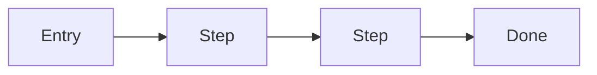

# UX brief — <feature name>

- **Source spec:** `<path>` (status: `<hardened|frozen>`, <earned|declared>) · **Mode:** PRODUCT · **Scope:** GREENFIELD | FEATURE-ADDITION
- **Author:** <name> · **Date:** <YYYY-MM-DD> · **Status:** `draft` | `ready` | `EXPLORATORY — spec not frozen`

> A functional + UX brief, **not** UI. It says what the user must be able to do and in what flow; visual and
> component design is owned downstream by `spec-to-design` and by a designer.
>
> **The brief is about the product, not about how it was written.** No list of documents read, no
> `status/version`, no narration of verification. What *does* belong: whether a claim rests on the spec or on an
> assumption — `[ASSUMPTION]` is content, because the reader must know which lines to trust.

## 1. Requirement index

The citable spine. Every flow, screen and interaction requirement below cites a number from this table, and
`spec-to-design` and `spec-to-code` cite it too. Where the source PRD already numbers its requirements, these
numbers **are** its numbers — never renumbered.

| # | Requirement | Source |
|---|---|---|
| R1 | <one line, in the spec's own words where possible> | §<n> |

Note any requirement you **split** (one line in the spec that was really several) or **merged** (two saying the
same thing), with the reason. Nothing else about the extraction belongs here.

## 2. Job & context

The user's job-to-be-done this flow serves, and the situation they're in when they arrive. Ties to the spec's
problem and target-user sections. Every claim about users is either grounded in the spec or tagged
`[ASSUMPTION]`.

## 3. User flows

The happy path as a story-map backbone — **activities → steps → tasks** — one flow per distinct user goal.
Mermaid inline, no external images.

For **FEATURE-ADDITION**: only the affected slice — the entry point into the new element, the element itself, and
what it introduces. Not a re-mapping of a flow that already works.

## 4. States & edge cases

Per screen: **empty / loading / error / success**, plus permission/eligibility and boundary conditions. What the
user sees, and what they can do, in each.

| Screen | State | What the user sees | What they can do |
|---|---|---|---|

Where the spec doesn't define a behaviour, the row says `[ASSUMPTION]` and the question goes to §7 — it is never
silently decided here.

## 5. Information architecture

The surfaces involved. For **each**:

- **What the user must be able to do here** — capability, not layout.
- **What information it shows** — and where it comes from.
- **Entry / exit** — how they arrive, where they go next.

Explicitly *not* visual layout, components, or hierarchy of pixels.

## 6. Interaction requirements

Numbered so `spec-to-code` can turn them into acceptance criteria and `spec-to-design` can cite them per screen.
Given/When/Then where it clarifies; a plain sentence where that's enough.

| # | Interaction requirement | Serves |
|---|---|---|
| UX-1 | … | R1 |

### Coverage matrix

Every `R` from §1, against what serves it. A requirement with no user-facing surface — validation, a
forward-compatibility rule, where content comes from — is listed with that reason. **No blank cells.**

| # | Served by | Note |
|---|---|---|
| R1 | Flow A, screens 2–3 | |
| R2 | — | no user-facing surface: <reason> |

## 7. Open questions

Unresolved items, each with **what's missing**, **who closes it**, and what the brief proceeds on in the
meantime if anything. Includes every `[ASSUMPTION]` above and every requirement not yet represented by a flow or
screen.

## 8. Constraints & non-goals for design

- **Accessibility** — the baseline the design must meet.
- **Design System boundary** — this brief does not define components; it states what must be possible.
- **Explicitly out** — what this brief deliberately does not cover, where a reader would otherwise assume it in.

---

**Length.** A normal feature brief is **two to four pages**. If it grows past that, either the feature is bigger
than it looked, or the brief is explaining rather than specifying. The second is more common.
